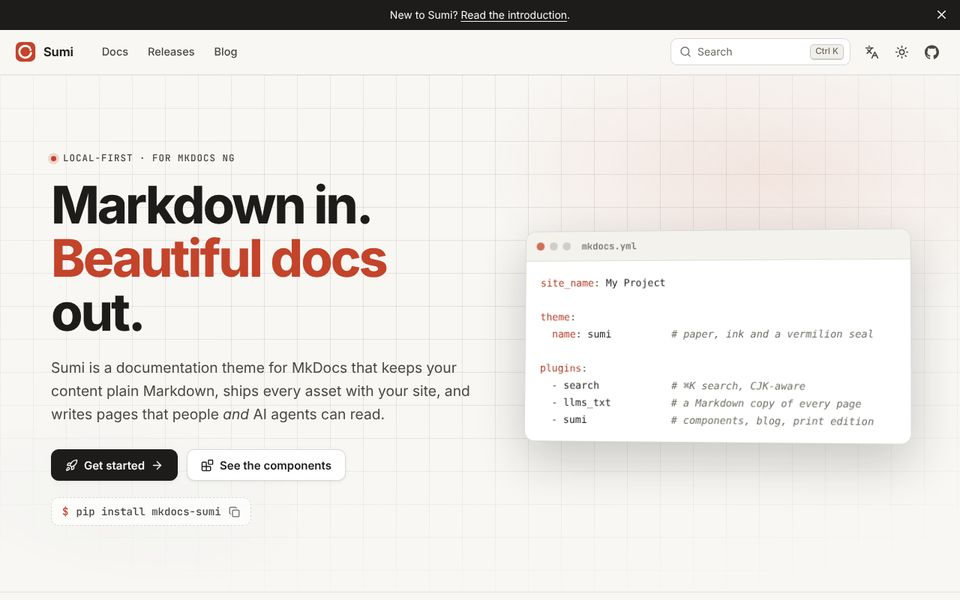
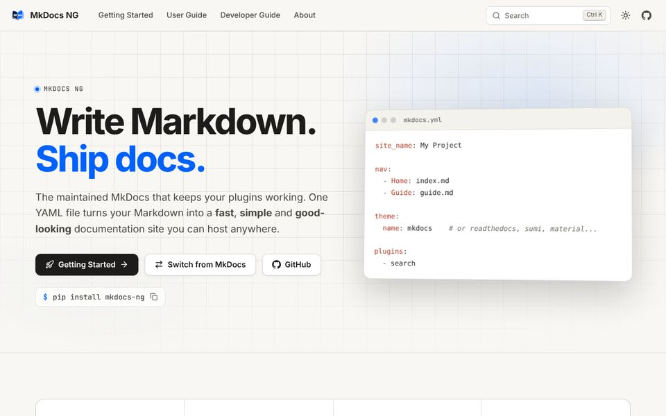
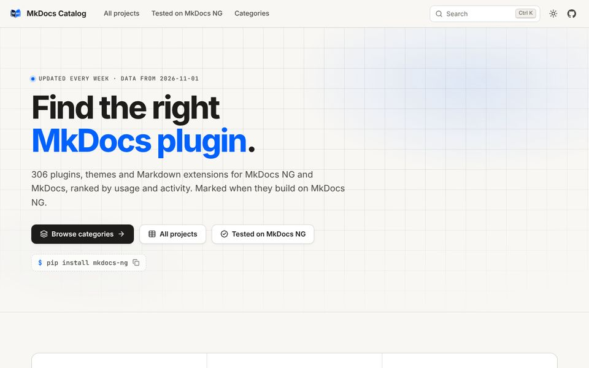
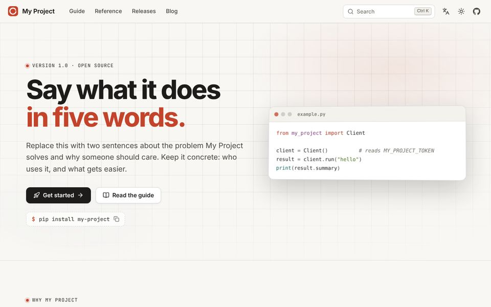
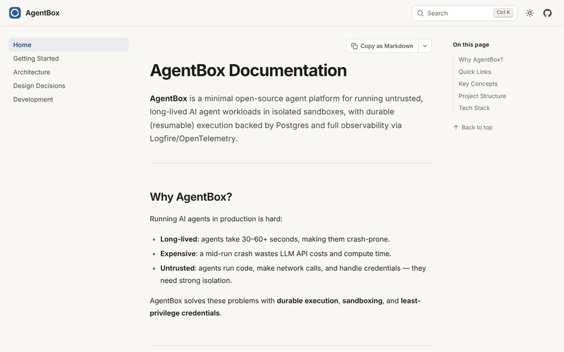
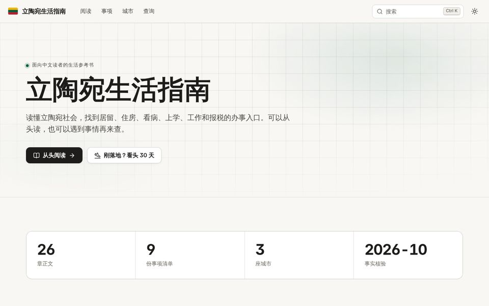
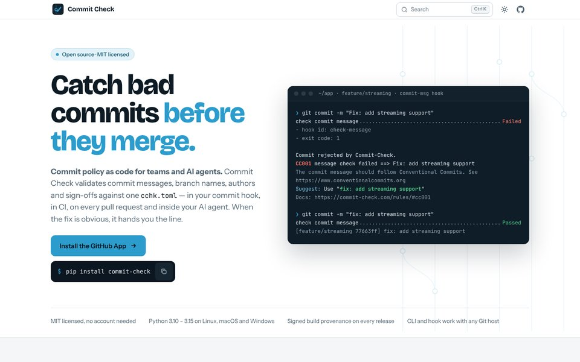

<p align="center">
  <a href="https://sumi.mkdocs-ng.org/">
    
  </a>
</p>

<h1 align="center">Sumi</h1>

<p align="center">
  <strong>Markdown in. Beautiful docs out.</strong>
</p>

<p align="center">
  <a href="https://pypi.org/project/mkdocs-sumi/"></a>
  <a href="https://pypi.org/project/mkdocs-sumi/"></a>
  <a href="https://github.com/mkdocs-ng/mkdocs-sumi/actions/workflows/ci.yml"></a>
  <a href="https://github.com/mkdocs-ng/mkdocs-sumi/blob/main/LICENSE"></a>
</p>

<p align="center">
  <a href="https://sumi.mkdocs-ng.org/">Documentation</a> ·
  <a href="https://sumi.mkdocs-ng.org/zh/">中文文档</a> ·
  <a href="https://sumi.mkdocs-ng.org/docs/write/">Components</a> ·
  <a href="https://sumi.mkdocs-ng.org/docs/start/compare/">Sumi vs Material</a> ·
  <a href="https://sumi.mkdocs-ng.org/releases/">Releases</a>
</p>

Sumi is a documentation theme for [MkDocs NG](https://github.com/mkdocs-ng/mkdocs). It turns a folder of plain Markdown into a complete project site — docs, landing page, blog, release downloads and a print edition — without Node.js, a CDN or a hosted service.

## Quick start

```sh
pip install mkdocs-sumi
```

```yaml
# mkdocs.yml
theme:
  name: sumi

plugins:
  - search
  - llms_txt   # optional: llms.txt and a Markdown copy of every page
  - sumi
```

```sh
mkdocs serve
```

## Highlights

- **Components in native Markdown.** Callouts are `> [!NOTE]`, steps are a numbered list with `{.steps}`, tabs are fences with `{tab="…"}`. Your source still reads well on GitHub.
- **Local-first.** Fonts, 2 000 icons, search, Mermaid and KaTeX ship with the theme. Mermaid and KaTeX load only on pages that use them.
- **Search as a command palette.** <kbd>⌘</kbd> <kbd>K</kbd> searches every heading, including Chinese and Japanese, and runs commands.
- **13 interface languages.** Arabic and Hebrew lay out right to left. With MkDocs NG, one `mkdocs.yml` builds every language, with a language menu and a side-by-side bilingual view.
- **Written for agents too.** Every page has a Markdown twin announced in `<head>`, plus `llms.txt` and *Copy as Markdown*.
- **One design for the whole project site.** Data-driven landing pages, a blog with tags and an Atom feed, a releases page with checksums, and a whole-site print edition.
- **Keeps your MkDocs content.** Admonitions, `pymdownx` tabs and details, `mike` versions and Material's `extra` keys keep working.

Coming from Material for MkDocs? [Sumi and Material compared](https://sumi.mkdocs-ng.org/docs/start/compare/) shows what Sumi adds and where Material is still ahead, and [Migrate from Material](https://sumi.mkdocs-ng.org/docs/start/migrate/) how to switch.

## Showcase

<table>
  <tr>
    <td width="33%"><a href="https://sumi.mkdocs-ng.org/"></a><br><sub>Sumi</sub></td>
    <td width="33%"><a href="https://mkdocs-ng.org/"></a><br><sub>MkDocs NG</sub></td>
    <td width="33%"><a href="https://catalog.mkdocs-ng.org/"></a><br><sub>MkDocs Catalog</sub></td>
  </tr>
  <tr>
    <td width="33%"><a href="https://mkdocs-ng.github.io/sumi-starter/"></a><br><sub>Sumi starter</sub></td>
    <td width="33%"><a href="https://shenxianpeng.dev/agentbox/"></a><br><sub>AgentBox</sub></td>
    <td width="33%"><a href="https://lt.shenxianpeng.dev/"></a><br><sub>立陶宛生活指南</sub></td>
  </tr>
  <tr>
    <td width="33%"><a href="https://commit-check.com/"></a><br><sub>Commit Check</sub></td>
  </tr>
</table>

More on the [showcase page](https://sumi.mkdocs-ng.org/showcase/). Built something with Sumi? [Tell us](https://github.com/mkdocs-ng/mkdocs-sumi/issues/new?title=Showcase:+).

## Development

```sh
pip install -e ".[test]"
pytest                       # unit and build tests
pip install playwright && playwright install chromium
pytest tests/test_browser.py # browser tests against the docs site
mkdocs serve                 # the docs site is the visual regression suite
```

## License

Sumi is part of the [MkDocs NG](https://github.com/mkdocs-ng) project.

Apache 2.0. See [NOTICE](https://github.com/mkdocs-ng/mkdocs-sumi/blob/main/NOTICE) for the licenses of bundled fonts, icons and libraries.
