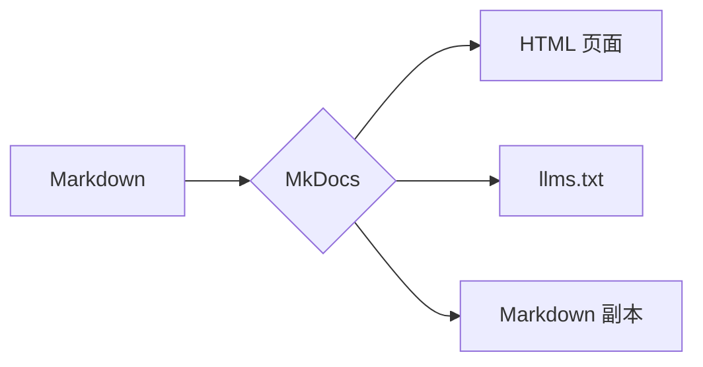
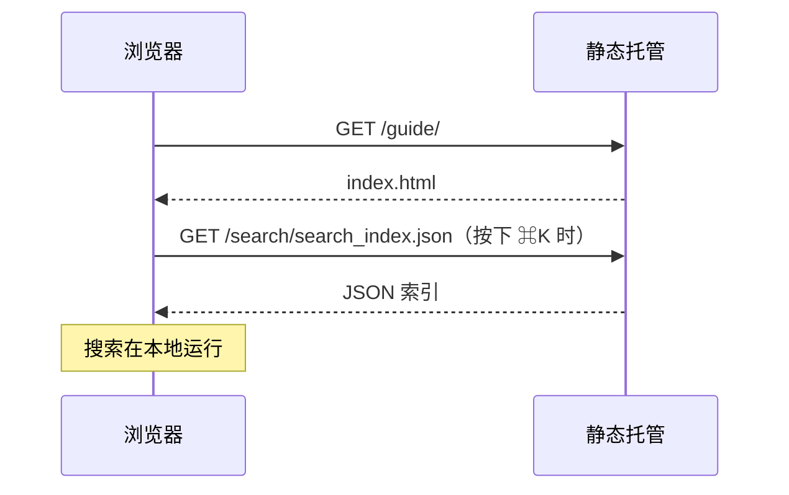
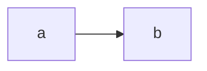
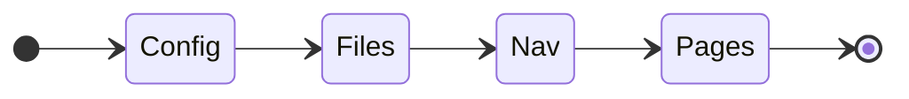

# 图表

`mermaid` 代码块会由 [Mermaid](https://mermaid.js.org/) 画成图表。Sumi 随主题附带 Mermaid，并且只在图表即将滚入视野时才加载它。Mermaid 按图表类型拆分，所以只有一张流程图的页面只下载流程图的代码，别的都不下载。其他页面完全不受影响。

````markdown

````


图表跟随配色：切换到深色模式，图表会重新绘制。

把鼠标移到图表上（手机上轻点一下），会出现三个按钮：全屏查看、复制 Mermaid 源码、下载为 SVG 文件。图表画出来之前，以及在没有 JavaScript 的浏览器中，读者看到的是它的源码文本。

## 时序图 {#sequence-diagrams}



## 图注 {#captions}

代码块上的 `title` 会成为图注：

````markdown

````



> [!NOTE]
> Mermaid 以 JavaScript 模块的形式加载，而浏览器不允许 `file://` 页面加载模块。请通过 Web 服务器打开构建好的站点（`mkdocs serve`、`python -m http.server`），或者部署到任意静态托管服务。

> [!NOTE]
> 如果你在 `pymdownx.superfences` 中为 Mermaid 配置了自定义代码块，请删掉它：Sumi 会自己处理 `mermaid` 代码块。要关闭 Sumi 的处理，在[插件](../customize/plugin.md)上设置 `mermaid: false`。
