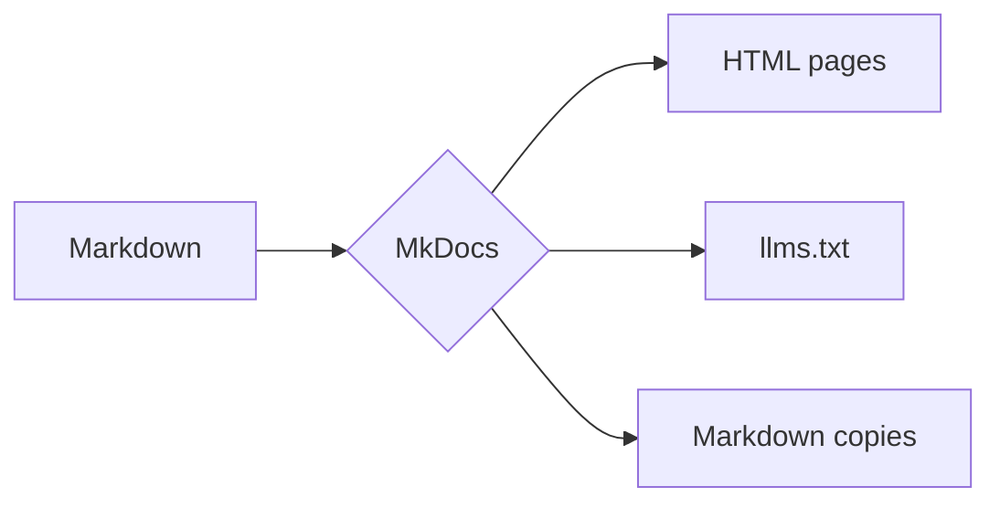
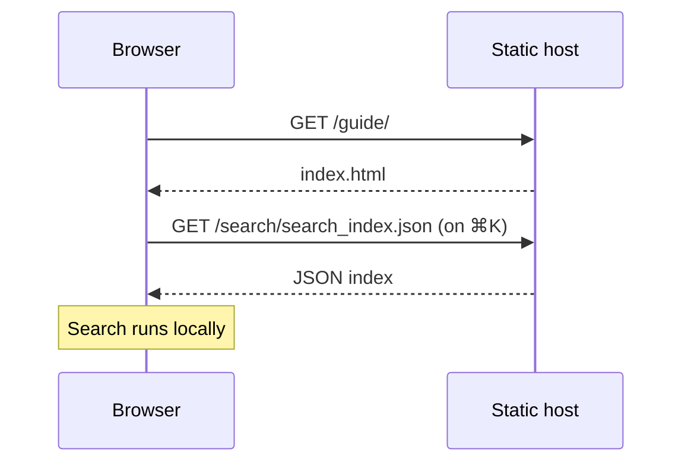
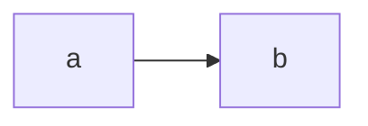
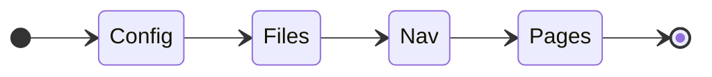

# Diagrams

A `mermaid` fence is drawn as a diagram by [Mermaid](https://mermaid.js.org/). Sumi bundles Mermaid with the theme and loads it only when a diagram is about to scroll into view. Mermaid is split by diagram type, so a page with one flowchart downloads the flowchart code and nothing else. Other pages do not pay for it at all.

````markdown

````


Diagrams follow the colour scheme: switch to dark mode and they are redrawn.

Hover a diagram (or tap it on a phone) for three buttons: open it full screen, copy its Mermaid source, and download it as an SVG file. Until a diagram is drawn, and in a browser without JavaScript, readers see its source text.

## Sequence diagrams



## Captions

A `title` on the fence becomes the caption:

````markdown

````



> [!NOTE]
> Mermaid is loaded as a JavaScript module, which browsers do not allow from `file://` pages. Open the built site through a web server (`mkdocs serve`, `python -m http.server`) or any static host.

> [!NOTE]
> If you use `pymdownx.superfences` with a custom fence for Mermaid, remove it: Sumi handles `mermaid` fences itself. To turn Sumi's handling off, set `mermaid: false` on the [plugin](../customize/plugin.md).
