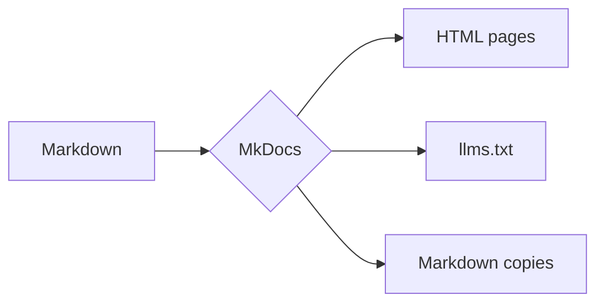
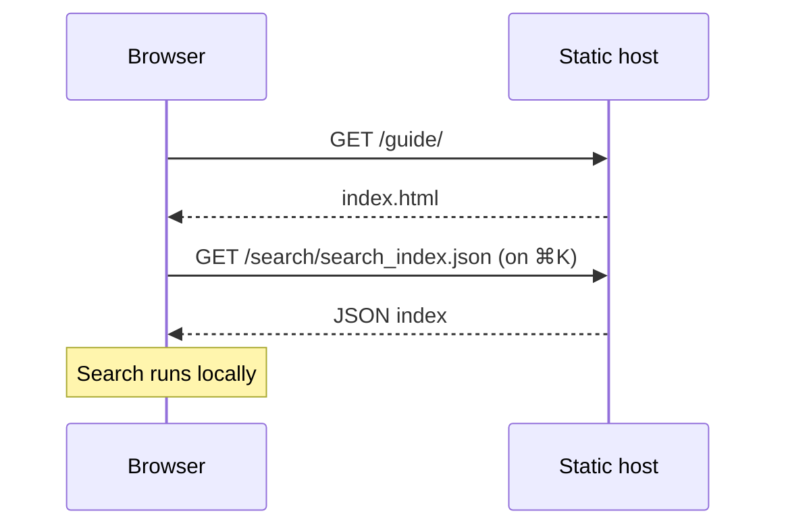
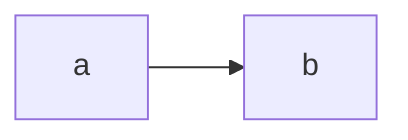
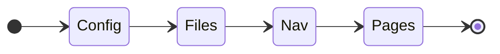

# Diagrams

A `mermaid` fence is drawn as a diagram by [Mermaid](https://mermaid.js.org/). Sumi bundles Mermaid with the theme and loads it only on pages that contain a diagram — other pages do not pay for it.

````markdown

````


Diagrams follow the colour scheme: switch to dark mode and they are redrawn.

## Sequence diagrams



## Captions

A `title` on the fence becomes the caption:

````markdown

````



> [!NOTE]
> If you use `pymdownx.superfences` with a custom fence for Mermaid, remove it: Sumi handles `mermaid` fences itself. To turn Sumi's handling off, set `mermaid: false` on the [plugin](../customize/plugin.md).
