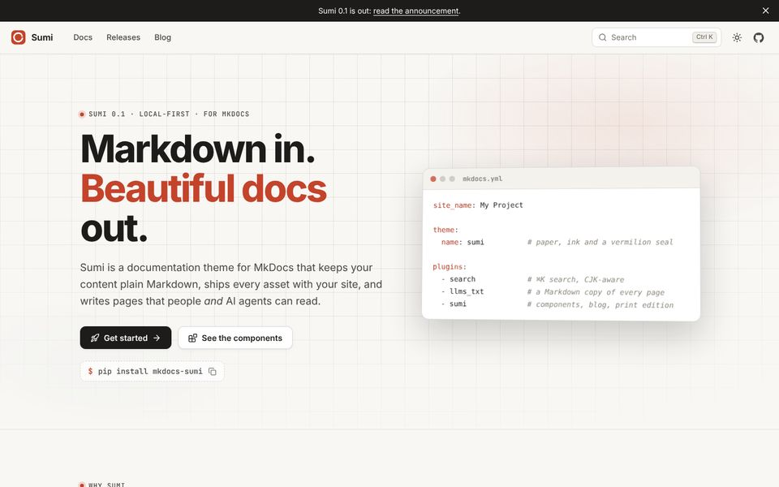
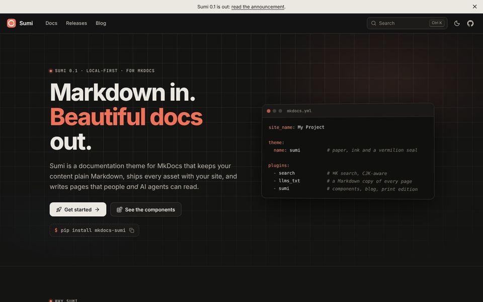
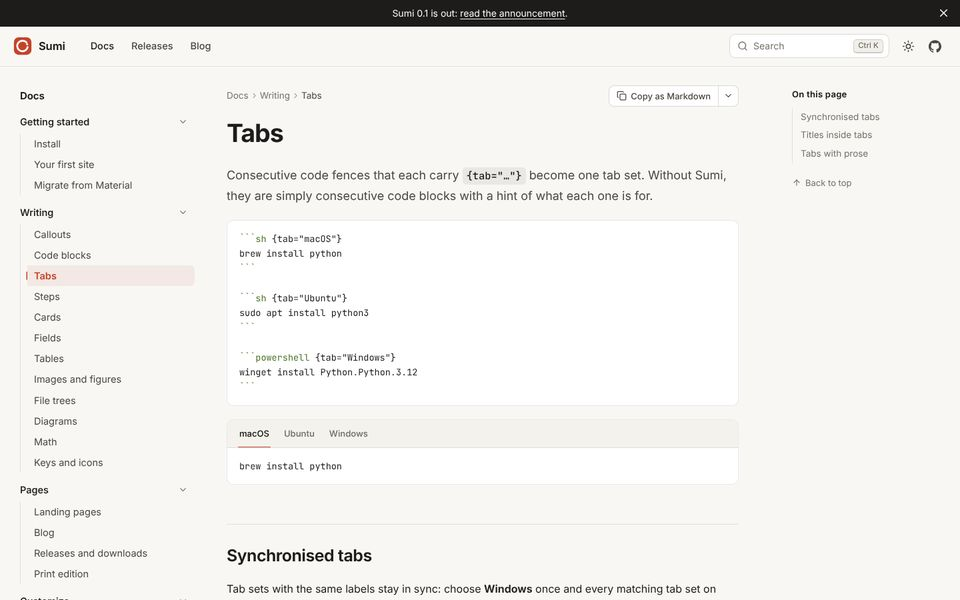
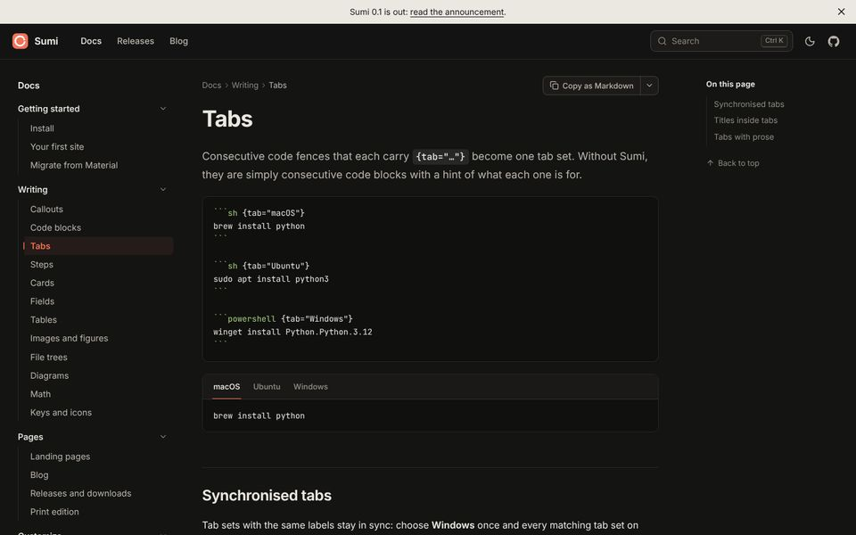
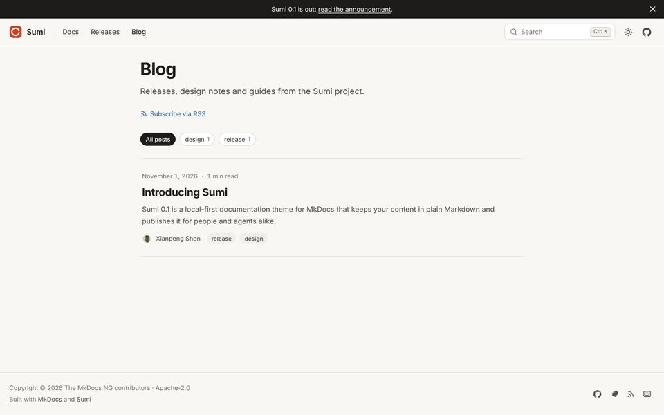
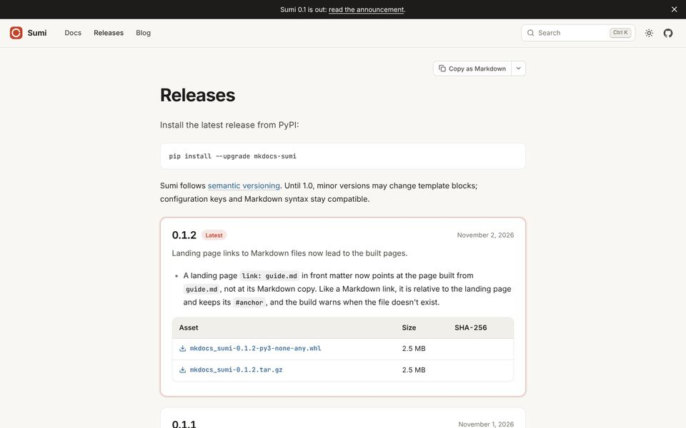

# Galleries

A bullet list of images followed by `{.gallery}` becomes an image grid. Text after an image is its caption. Click an image to see it full size.

```markdown
- 
  Home page
- 
  Dark mode
- 
  Documentation
- 
  Documentation, dark
- 
  Blog
- 
  Releases and downloads
{.gallery}
```

- 
  Home page
- 
  Dark mode
- 
  Documentation
- 
  Documentation, dark
- 
  Blog
- 
  Releases and downloads
{.gallery}

On GitHub and in the Markdown copy of the page, this is still a list of images with captions.

## Columns and shape

The grid fits as many columns as there is room for, up to three. Set `cols` to change that. Images are cropped to 4:3; set `--ratio` in `style` for another shape:

```markdown
- 
- 
{.gallery cols="2" style="--ratio: 16 / 10"}
```

- 
  Light
- 
  Dark
{.gallery cols="2" style="--ratio: 16 / 10"}

## Links

Wrap an image in a link to open a page instead of the full-size image:

```markdown
- [](../pages/blog.md)
  Blog layout
{.gallery}
```

## Reference

| What | Details |
| --- | --- |
| Output | `<ul class="sumi-gallery">`, one `<figure>` per image, with lazy-loaded images. |
| Without Sumi | A list of images with captions. |
| JavaScript | Only for full-size viewing. |
| Limits | Images are cropped to the same shape, so keep important detail near the centre. |
{.compact}
