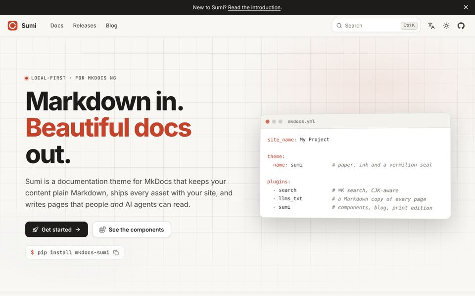
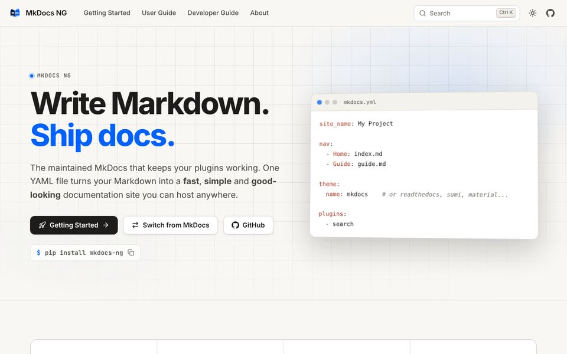
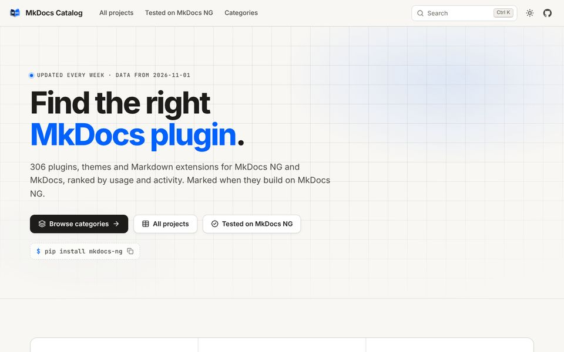
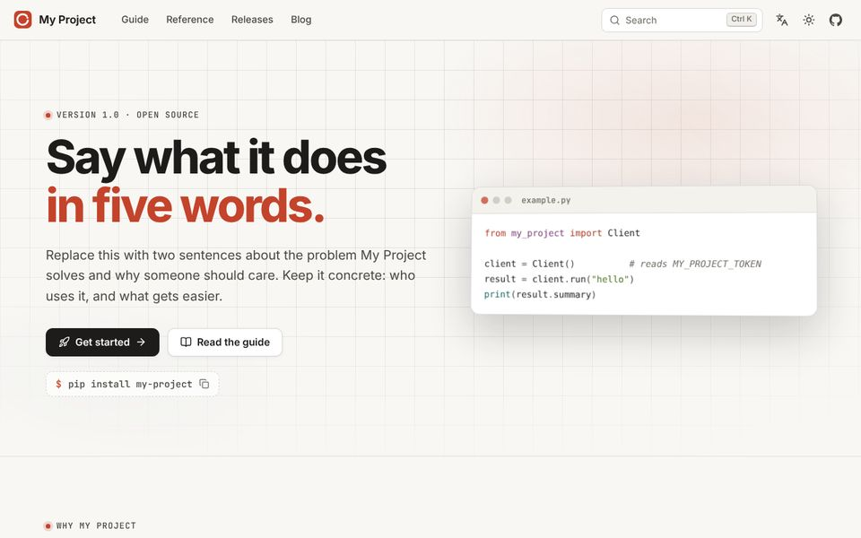
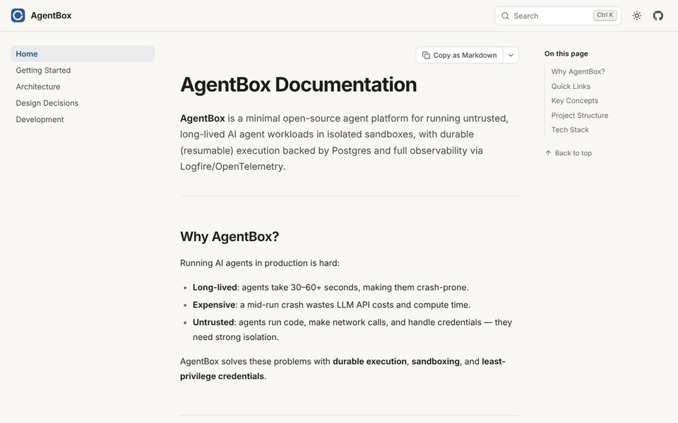
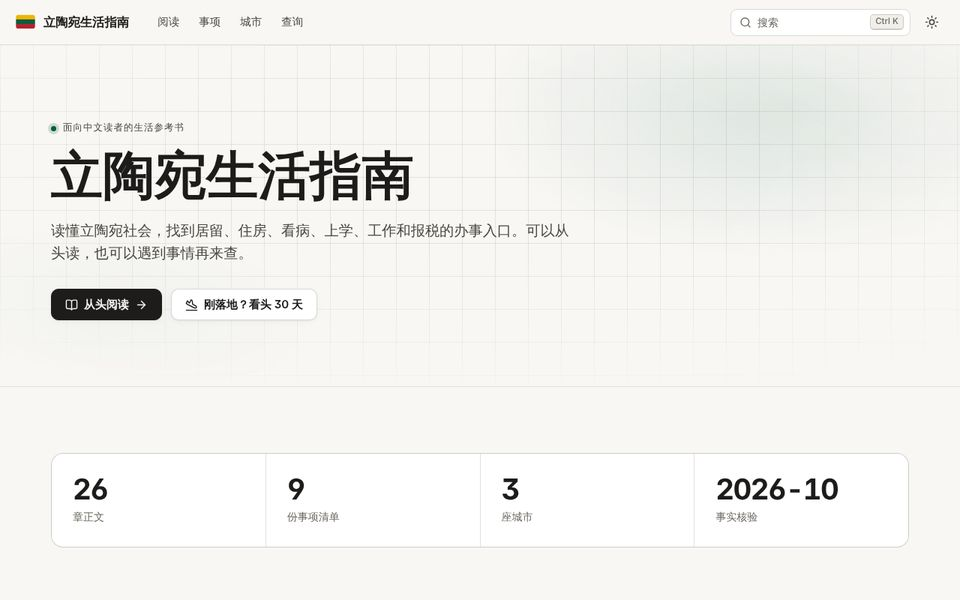

# Showcase

Sites built with Sumi, each with a note on the parts of Sumi it uses. Click a screenshot to visit the site.

- 
  Sumi
- 
  MkDocs NG
- 
  MkDocs Catalog
- 
  Sumi starter
- 
  AgentBox
- 
  立陶宛生活指南
{.gallery cols="2" style="--ratio: 16 / 10"}

## The sites

| Site | What it is | Sumi parts it uses |
| --- | --- | --- |
| [Sumi](https://sumi.mkdocs-ng.org/) | This site | Landing page, docs, blog in cards, releases page, print edition, English and Chinese with the bilingual view, `llms.txt` |
| [MkDocs NG](https://mkdocs-ng.org/) | The maintained MkDocs | Landing page with figures, user and developer guides, a comparison page, release notes |
| [MkDocs Catalog](https://catalog.mkdocs-ng.org/) | A directory of MkDocs plugins | Landing page with figures, cards, large generated tables rebuilt every week |
| [Sumi starter](https://mkdocs-ng.github.io/sumi-starter/) | A template repository to copy | Landing page, guide, reference, releases and blog in English and Chinese, deployed to GitHub Pages |
| [AgentBox](https://shenxianpeng.dev/agentbox/) | Docs for an open-source agent platform | A docs-only site: sidebar, table of contents, cards, tables and code |
| [立陶宛生活指南](https://lt.shenxianpeng.dev/) | A Chinese guide to living in Lithuania | Chinese interface and typography, landing page with figures, CJK search, a long reference book |
{.compact}

## Add your site

Built a site with Sumi? [Open an issue](https://github.com/mkdocs-ng/mkdocs-sumi/issues/new?title=Showcase:+) with its address and a sentence about it, or send a pull request that adds a 960×600 screenshot to `docs/assets/showcase/` and a row to this page.
